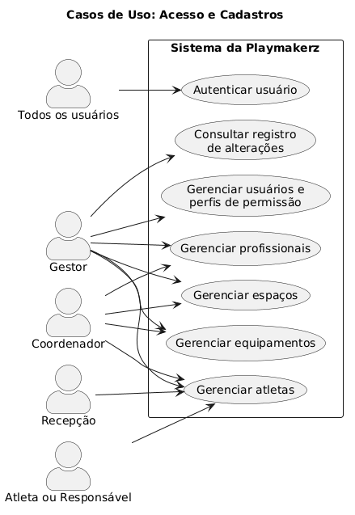
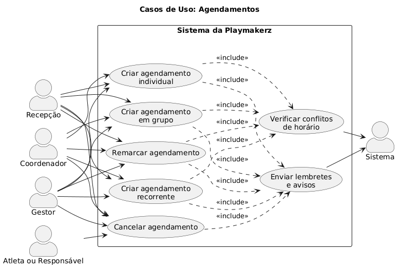
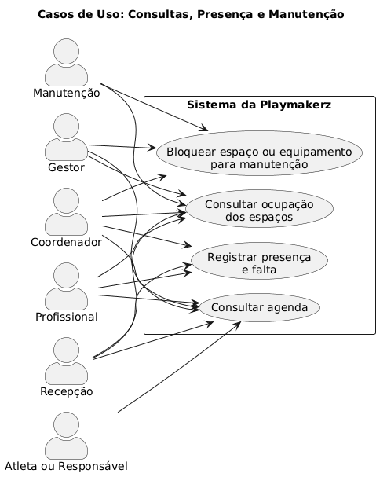

## 1 Objetivo

    Este documento descreve os casos de uso do sistema de gestão esportiva da Playmakerz, centro de treinamento de alta performance localizado na Barra da Tijuca (RJ). Ele detalha como cada tipo de usuário interage com o sistema para organizar atendimentos, profissionais, espaços e equipamentos, evitando conflitos de horário e protegendo os dados pessoais, principalmente os de crianças e adolescentes.  O documento cobre as funcionalidades previstas no escopo inicial do projeto (documento de Pesquisa): cadastros, agenda de atendimentos, verificação de conflitos, agendamentos individuais, em grupo e recorrentes, controle de presença, faltas e cancelamentos, bloqueio de recursos em manutenção, perfis de permissão, lembretes e consulta de ocupação.

    Esta versão foi atualizada depois do início da construção do sistema. Cada caso de uso passou a informar sua <b>situação de implementação</b> (seção 3) e a especificação (seção 4) descreve o comportamento que o código realmente tem, indicando como <b>planejado</b> o que ainda não foi construído. Também foram incluídos quatro casos de uso que surgiram durante o desenvolvimento: Consultar horários do profissional, Inscrever atleta em atividade em grupo, Agendar aula experimental e Cancelar participação.

---

## 2. Atores

| Ator | Tipo | Descrição |
|------|------|-----------|
| **Gestor** | Principal | Administra a academia, os usuários e as permissões, e acompanha a operação. |
| **Recepção** | Principal | Organiza os horários, cria e altera agendamentos, atende atletas e responsáveis e registra as aulas experimentais. |
| **Coordenador** | Principal | Supervisiona treinadores, agendas e recursos. |
| **Profissional** | Principal | Treinador ou outro profissional que consulta sua agenda e registra presença. |
| **Manutenção** | Principal | Funcionário que bloqueia e libera espaços e equipamentos. |
| **Atleta** | Principal | Consulta seus próprios agendamentos e dados. |
| **Responsável** | Principal | Faz o mesmo que o atleta, em nome do menor de idade. |
| **Sistema (temporizador)** | Secundário | Dispara lembretes e avisos automáticos nos horários definidos. |

---

## 3. Situação de implementação

### 3.1 Legenda

| Situação | Significado |
|----------|-------------|
| **Implementado** | O fluxo principal existe no código e é coberto por testes automatizados. |
| **Parcial** | Parte do fluxo existe. As lacunas estão indicadas na especificação do caso de uso. |
| **Planejado** | Ainda não existe no código. A especificação (seção 4) mostra o que foi previsto. |

### 3.2 Resumo por caso de uso

Dos 22 casos de uso, 11 estão implementados, 4 estão parciais e 7 estão planejados.

| Caso de uso | Situação | Onde está no código | Testes automatizados |
|-------------|----------|---------------------|----------------------|
| [Autenticar usuário](#autenticar-usuario) | Parcial | Login do Django (`/admin/login/`); a API aceita sessão ou Basic Auth (`project/settings.py`) | `agendamentos/test_interface.py`; `api/tests.py` |
| [Gerenciar usuários e perfis de permissão](#gerenciar-usuarios-e-perfis-de-permissao) | Parcial | Django admin: `Usuario`, `Responsavel`, `Profissional`, `Funcionario` (`usuarios/admin.py`) | `usuarios/tests.py`; `usuarios/test_admin.py` |
| [Gerenciar atletas](#gerenciar-atletas) | Implementado | API `/api/atletas/` (`api/views.py`); Django admin; cadastro rápido na tela de agendamento | `api/tests.py` (`AtletaAPITests`, `AtletaModelTests`); `usuarios/tests.py` |
| [Gerenciar profissionais](#gerenciar-profissionais) | Parcial | Django admin, com horários de disponibilidade (`usuarios/admin.py`) | `usuarios/tests.py`; `usuarios/test_admin.py` |
| [Gerenciar espaços](#gerenciar-espacos) | Implementado | API `/api/espacos/`; Django admin | `api/tests.py` (`EspacoAPITests`, `EspacoModelTests`) |
| [Gerenciar equipamentos](#gerenciar-equipamentos) | Implementado | API `/api/equipamentos/`; Django admin | `api/tests.py` (`EquipamentoAPITests`, `EquipamentoModelTests`) |
| [Consultar horários do profissional](#consultar-horarios-do-profissional) | Implementado | `GET /agendamentos/horarios/`; grade da tela de novo agendamento; `listar_horarios_profissional` (`agendamentos/services.py`) | `agendamentos/tests.py`; `agendamentos/test_interface.py` |
| [Criar agendamento individual](#criar-agendamento-individual) | Implementado | `POST /api/agendamentos/`; tela `/agendamentos/novo/`; `criar_agendamento` (`agendamentos/services.py`) | `api/tests.py` (`AgendamentoAPITests`, `RecursosAgendamentoAPITests`); `agendamentos/tests.py`; `agendamentos/test_interface.py` |
| [Criar agendamento em grupo](#criar-agendamento-em-grupo) | Implementado | Os mesmos de agendamento individual, com modalidade "grupo" | `api/tests.py`; `agendamentos/tests.py`; `agendamentos/test_interface.py` |
| [Inscrever atleta em atividade em grupo](#inscrever-atleta-em-atividade-em-grupo) | Implementado | `POST /api/agendamentos/{id}/inscrever/`; tela de novo agendamento; `inscrever_em_atividade_grupo` | `api/tests.py`; `agendamentos/tests.py`; `agendamentos/test_interface.py` |
| [Agendar aula experimental](#agendar-aula-experimental) | Implementado | Cadastro rápido na tela de novo agendamento; parâmetro `atletas_experimentais` da API | `agendamentos/tests.py`; `agendamentos/test_interface.py` |
| [Criar agendamento recorrente](#criar-agendamento-recorrente) | Planejado | Não existe | — |
| [Verificar conflitos de horário](#verificar-conflitos-de-horario) | Implementado | `_validar_conflitos` e `_validar_disponibilidade` (`agendamentos/services.py`) | `api/tests.py`; `agendamentos/tests.py` |
| [Remarcar agendamento](#remarcar-agendamento) | Planejado | Não existe | — |
| [Cancelar agendamento](#cancelar-agendamento) | Implementado | `POST /api/agendamentos/{id}/cancelar/`; tela de detalhe; `cancelar_agendamento` | `api/tests.py`; `agendamentos/tests.py`; `agendamentos/test_interface.py` |
| [Cancelar participação](#cancelar-participacao) | Implementado | `POST /api/agendamentos/{id}/participacoes/{participacao_id}/cancelar/`; tela de detalhe; `cancelar_participacao` | `api/tests.py`; `agendamentos/tests.py`; `agendamentos/test_interface.py` |
| [Consultar agenda](#consultar-agenda) | Parcial | Telas `/agendamentos/` e `/agendamentos/{id}/` (`agendamentos/views.py`) | `agendamentos/test_interface.py` |
| [Registrar presença e falta](#registrar-presenca-e-falta) | Planejado | Só o modelo: `ParticipacaoAgendamento` já tem as situações de presença e falta | — |
| [Bloquear espaço ou equipamento para manutenção](#bloquear-espaco-ou-equipamento-para-manutencao) | Planejado | Não existe | — |
| [Consultar ocupação dos espaços](#consultar-ocupacao-dos-espacos) | Planejado | Não existe | — |
| [Enviar lembretes e avisos](#enviar-lembretes-e-avisos) | Planejado | Não existe | — |
| [Consultar registro de alterações](#consultar-registro-de-alteracoes) | Planejado | Não existe | — |

### 3.3 Acesso e perfis no código atual

- **Interface de agendamentos** (`/agendamentos/...`): exige um usuário com acesso de equipe (`is_staff`). Sem login, o sistema redireciona para o login do Django.
- **API** (`/api/...`): exige autenticação por sessão ou Basic Auth. Qualquer usuário autenticado acessa todas as rotas; sem login, a API responde 403.
- **Perfis:** `Atleta`, `Responsavel`, `Profissional` e `Funcionario` existem como cadastros ligados a `Usuario`, mas ainda não limitam o que cada usuário vê ou faz. Os papéis Gestor, Coordenador e Manutenção não existem como perfil. `Funcionario.cargo` é um texto livre, e só o cargo "Recepcionista" tem efeito, na aula experimental.
- **Agendamentos no Django admin:** `Agendamento` não está registrado no admin. Ele é criado e cancelado apenas pela interface e pela API.

### 3.4 Principais diferenças entre o planejamento e o código

| Tema | Planejado | No código |
|------|-----------|-----------|
| Menor de idade sem responsável | O sistema impede salvar o cadastro. | O cadastro é salvo. A exigência de responsável vale na hora de agendar. O cadastro rápido da aula experimental só aceita maiores de 18 anos. |
| Espaço | Nenhum espaço participa de dois agendamentos sobrepostos. | Vários agendamentos podem usar o mesmo espaço no mesmo horário, desde que a soma dos limites de participantes não passe da capacidade. |
| Equipamento | Cadastro com nome, categoria, quantidade e espaço. | Cadastro com nome e tipo. Cada equipamento é uma unidade e não pode estar em dois agendamentos sobrepostos. |
| Horário do agendamento | Início e fim livres, dentro do funcionamento. | Horários em intervalos de 30 minutos, no mesmo dia, entre 07:00 e 12:00 ou entre 13:00 e 20:00, e dentro da disponibilidade semanal do profissional. A tela reserva blocos de 30 minutos. A API aceita períodos maiores, em múltiplos de 30 minutos, dentro de uma mesma janela. |
| Atividade em grupo | Nome do grupo; número de atletas até a capacidade do espaço. | Limite de participantes entre 2 e a capacidade do espaço, e os atletas entram até esse limite. Não há nome de grupo. |
| Inativação | Atletas, profissionais, espaços e equipamentos são inativados, nunca excluídos. | Atleta, profissional e funcionário têm o campo `ativo`. Espaço e equipamento não têm. A exclusão é permitida, mas o banco a bloqueia quando há agendamento ou participação vinculados. A API ainda não transforma esse bloqueio em uma resposta amigável. |
| Registro das operações | Toda operação importante é registrada com usuário, data e hora. | O agendamento guarda quem o registrou, quando foi criado e quando foi alterado. O cancelamento guarda motivo e data, mas não o autor. Não há registro geral de alterações. |
| Consulta da agenda | Por dia, semana ou mês, com filtros e visão por perfil. | Lista de todos os agendamentos, do mais recente para o mais antigo, e tela de detalhe. Sem filtros e sem calendário. |
| Cancelar o que já está cancelado | O sistema não permite a operação. | A operação é aceita e devolve o estado atual, sem alterar nada. |

---

## 4. Especificação dos casos de uso

### Autenticar usuário

| Campo | Descrição |
|-------|-----------|
| **Situação** | **Parcial.** O acesso usa o login do Django (usuário e senha). Ainda não há tela própria de login, redefinição de senha, bloqueio por tentativas excessivas nem identificação do perfil na entrada. |
| **Descrição** | Permite que um usuário cadastrado acesse o sistema com sua conta individual. |
| **Atores** | Todos os usuários. |
| **Pré-condições** | O usuário possui conta ativa. |
| **Pós-condições** | O usuário é autenticado e acessa as funções liberadas para a sua conta. |
| **Regras de negócio** | Cada usuário possui conta individual, sem compartilhamento de credenciais. A interface de agendamentos exige acesso de equipe e a API exige autenticação (seção 3.3). Limitar cada perfil às informações da sua função é planejado. |

**Fluxo principal**
1. O usuário acessa a interface, a API ou o login do Django (`/admin/login/`).
2. O usuário informa suas credenciais.
3. O sistema valida as credenciais.
4. O sistema libera o acesso. A abertura de uma página inicial com as funções do perfil é planejada.

**Fluxos alternativos**
- **Esqueci a senha (planejado):** no passo 2, o usuário solicita a redefinição. O sistema envia as instruções para o contato cadastrado.

**Fluxos de exceção**
- **Credenciais inválidas:** o sistema exibe mensagem de erro e permite nova tentativa.
- **Conta inativa:** o Django recusa o login.
- **Usuário sem acesso de equipe tenta abrir a interface de agendamentos:** o sistema redireciona para o login.
- **Sem autenticação na API:** o sistema responde 403.
- **Tentativas excessivas (planejado):** o sistema bloqueia temporariamente novas tentativas e registra o evento.

---

### Gerenciar usuários e perfis de permissão

| Campo | Descrição |
|-------|-----------|
| **Situação** | **Parcial.** O cadastro é feito no Django admin. Não há permissões por perfil, envio do primeiro acesso nem registro de alterações próprio. |
| **Descrição** | Permite criar, editar, inativar usuários e definir o perfil de permissão de cada um. |
| **Atores** | Gestor. No código, um usuário com acesso de equipe e permissão no Django admin. |
| **Pré-condições** | Gestor autenticado no sistema. |
| **Pós-condições** | Usuário criado ou alterado com o perfil correto. |
| **Regras de negócio** | Cada usuário possui conta individual: `Usuario` é ligado a uma única conta do Django. Os perfis `Atleta`, `Responsavel`, `Profissional` e `Funcionario` são cadastros separados, ligados a `Usuario`. O telefone, quando informado, deve ter pelo menos 11 dígitos. Um usuário não pode ter dois perfis do mesmo tipo. Atleta, profissional e funcionário têm o campo `ativo`, usado para inativar em vez de excluir. Um `Usuario` com perfil vinculado não pode ser excluído. |

**Fluxo principal**
1. O gestor acessa o Django admin.
2. O gestor cria a conta do Django (usuário e senha) e o `Usuario` correspondente, com telefone opcional.
3. O gestor cria o perfil (atleta, responsável, profissional ou funcionário) ligado ao `Usuario`.
4. O sistema valida os dados e salva.

**Fluxos alternativos**
- **Inativar:** o gestor desmarca `ativo` no perfil. Profissional ou atleta inativo não recebe novos agendamentos.
- **Alterar perfil (planejado):** definir Gestor, Recepção, Coordenador, Profissional, Manutenção, Atleta ou Responsável como permissões que mudam o que o usuário acessa.
- **Primeiro acesso (planejado):** o sistema envia ao usuário o primeiro acesso.
- **Registro das alterações (planejado):** o sistema registra a operação. Hoje, o histórico de cada objeto no Django admin guarda apenas as alterações feitas por ele.

**Fluxos de exceção**
- **Telefone inválido:** o sistema informa que o telefone deve ter pelo menos 11 dígitos e não salva.
- **Usuário já possui o mesmo perfil:** o sistema não permite o segundo cadastro.
- **Excluir usuário com perfil vinculado:** o banco bloqueia a exclusão.
- **Contato já cadastrado e último gestor ativo (planejado):** o sistema impediria a duplicidade e a inativação do último gestor.

---

### Gerenciar atletas

| Campo | Descrição |
|-------|-----------|
| **Situação** | **Implementado.** Cadastro, consulta, edição, inativação e exclusão pela API e pelo Django admin, e cadastro rápido de interessados na tela de agendamento. Perfis de permissão, dados sensíveis e alerta de duplicidade são planejados. |
| **Descrição** | Permite cadastrar, consultar, editar e inativar atletas, incluindo o vínculo com responsáveis quando o atleta for menor de idade. |
| **Atores** | Gestor, Recepção, Coordenador. Atleta e Responsável, com visão restrita (consulta e atualização de dados de contato), são planejados. No código, qualquer usuário autenticado usa a API. |
| **Pré-condições** | Usuário autenticado. |
| **Pós-condições** | Cadastro criado ou alterado. |
| **Regras de negócio** | O nome é obrigatório. O e-mail, se informado, deve ser válido. O telefone, se informado, deve ter pelo menos 11 dígitos. A data de nascimento não pode estar no futuro. A idade é calculada pelo sistema e não pode ser enviada. Atleta e `Usuario` (login) são opcionais: o interessado pode existir sem conta. Um atleta tem no máximo um responsável, e um responsável pode ter vários atletas. Atleta inativo não é agendado. Atleta menor de 18 anos só agenda se tiver responsável vinculado. Um atleta com participações em agendamentos não pode ser excluído. |

**Fluxo principal**
1. O usuário acessa os atletas (API `/api/atletas/` ou Django admin) e escolhe cadastrar um novo.
2. O usuário informa o nome e os demais dados (e-mail, telefone, data de nascimento, objetivos).
3. O sistema valida o nome, o e-mail, o telefone e a data de nascimento.
4. O sistema salva o cadastro e devolve os dados com a idade calculada (API: HTTP 201).

**Fluxos alternativos**
- **Atleta menor de idade:** o usuário vincula o responsável no cadastro. O vínculo pode ser feito depois, mas é exigido para agendar.
- **Editar ou atualizar dados:** o usuário altera os campos (PUT ou PATCH). Na edição parcial, a validação usa os dados que já estão salvos.
- **Inativar atleta:** o usuário marca `ativo` como falso. O cadastro e o histórico permanecem, e o sistema impede novos agendamentos.
- **Cadastro rápido de interessado:** a recepção cadastra o interessado ao agendar a aula experimental (ver Agendar aula experimental).
- **Listar atletas:** a API devolve os atletas em ordem alfabética de nome.
- **Dados sensíveis e permissões por perfil (planejado):** somente perfis autorizados veem dados de saúde; atleta e responsável acessam só os dados do próprio atleta.

**Fluxos de exceção**
- **Dados inválidos:** o sistema devolve HTTP 400 com o campo e o motivo (nome ausente, e-mail inválido, telefone curto, nascimento futuro) e não salva.
- **Atleta inexistente:** o sistema devolve HTTP 404.
- **Sem autenticação:** o sistema devolve HTTP 403.
- **Excluir atleta com participações:** o banco bloqueia a exclusão. A API ainda não converte esse bloqueio em uma resposta amigável.
- **Atleta menor sem responsável:** o cadastro é salvo, mas o agendamento é rejeitado (ver Criar agendamento individual).
- **Atleta possivelmente duplicado (planejado):** o sistema alertaria e pediria confirmação antes de salvar.

---

### Gerenciar profissionais

| Campo | Descrição |
|-------|-----------|
| **Situação** | **Parcial.** O cadastro e a disponibilidade são feitos no Django admin. Não há API, nem verificação de agendamentos futuros ao editar a disponibilidade ou inativar. |
| **Descrição** | Permite cadastrar e manter treinadores e outros profissionais, com sua função e disponibilidade de atendimento. |
| **Atores** | Gestor, Coordenador. No código, um usuário com permissão no Django admin. |
| **Pré-condições** | Usuário autenticado com permissão. |
| **Pós-condições** | Profissional cadastrado ou alterado. |
| **Regras de negócio** | Um profissional não pode participar de dois agendamentos com horários sobrepostos. A especialidade é obrigatória. Cada horário de disponibilidade tem dia da semana, início e fim; o fim é posterior ao início, ambos em intervalos de 30 minutos, dentro das janelas 07:00 às 12:00 ou 13:00 às 20:00. Profissional inativo não recebe agendamentos e não aparece no formulário de agendamento. |

**Fluxo principal**
1. O usuário acessa "Profissionais" no Django admin e seleciona adicionar.
2. O usuário escolhe o `Usuario`, informa a especialidade e os dias e horários de disponibilidade (seção "Horários disponíveis").
3. O sistema valida e salva o profissional e a disponibilidade juntos.

**Fluxos alternativos**
- **Editar disponibilidade:** o usuário altera os horários. A verificação de agendamentos futuros fora do novo horário, com a lista para remarcar, é planejada.
- **Inativar profissional:** o usuário desmarca `ativo`. O sistema impede novos agendamentos. Exigir antes a remarcação ou o cancelamento dos agendamentos futuros é planejado.

**Fluxos de exceção**
- **Campos obrigatórios ausentes:** o sistema destaca os campos e não salva.
- **Horário fora das janelas, no almoço, fora dos intervalos de 30 minutos ou com fim não posterior ao início:** o sistema não salva a disponibilidade.

---

### Gerenciar espaços

| Campo | Descrição |
|-------|-----------|
| **Situação** | **Implementado.** Cadastro, consulta, edição e exclusão pela API e pelo Django admin. Horário de funcionamento, inativação e bloqueio por manutenção são planejados. |
| **Descrição** | Permite cadastrar e manter os espaços de treino (ex.: quadras, salas, áreas de musculação) com nome, tipo e capacidade. |
| **Atores** | Gestor, Coordenador. No código, qualquer usuário autenticado usa a API. |
| **Pré-condições** | Usuário autenticado. |
| **Pós-condições** | Espaço cadastrado ou alterado. |
| **Regras de negócio** | Nome, tipo e capacidade são obrigatórios; a capacidade é um número inteiro, nunca negativo. O limite de participantes de um agendamento não pode superar a capacidade do espaço. A soma dos limites dos agendamentos sobrepostos no mesmo espaço não pode superar a capacidade. Um espaço com agendamentos não pode ser excluído. Um espaço bloqueado para manutenção não pode ser agendado no período do bloqueio (planejado). |

**Fluxo principal**
1. O usuário acessa os espaços (API `/api/espacos/` ou Django admin) e escolhe cadastrar um novo.
2. O usuário informa nome, tipo e capacidade máxima.
3. O sistema valida e salva (API: HTTP 201).

**Fluxos alternativos**
- **Editar espaço:** o usuário altera nome, tipo ou capacidade (PUT ou PATCH). Verificar agendamentos futuros acima da nova capacidade é planejado.
- **Listar espaços:** a API devolve os espaços em ordem alfabética de nome.
- **Horário de funcionamento e inativação (planejados):** hoje o horário de atendimento é único para todo o sistema, e o espaço não tem campo `ativo`.

**Fluxos de exceção**
- **Dados inválidos:** o sistema devolve HTTP 400 com o campo e o motivo (nome ausente, capacidade negativa) e não salva.
- **Espaço inexistente:** o sistema devolve HTTP 404.
- **Sem autenticação:** o sistema devolve HTTP 403.
- **Excluir espaço com agendamentos:** o banco bloqueia a exclusão. A API ainda não converte esse bloqueio em uma resposta amigável.
- **Capacidade zero:** o cadastro aceita, mas nenhum agendamento cabe nesse espaço.
- **Nome de espaço duplicado (planejado):** o sistema não permitiria salvar. Hoje o nome pode se repetir.

---

### Gerenciar equipamentos

| Campo | Descrição |
|-------|-----------|
| **Situação** | **Implementado.** Cadastro, consulta, edição e exclusão pela API e pelo Django admin. Categoria, quantidade, espaço de origem, inativação e bloqueio por manutenção são planejados. |
| **Descrição** | Permite cadastrar e manter os equipamentos que podem ser reservados junto aos atendimentos. |
| **Atores** | Gestor, Coordenador. No código, qualquer usuário autenticado usa a API. |
| **Pré-condições** | Usuário autenticado. |
| **Pós-condições** | Equipamento cadastrado ou alterado. |
| **Regras de negócio** | Nome e tipo são obrigatórios. Cada equipamento é uma unidade: não pode participar de dois agendamentos sobrepostos que não estejam cancelados. Agendamentos que terminam no horário em que outro começa não se sobrepõem. Excluir um equipamento o remove dos agendamentos em que ele estava reservado. Um equipamento bloqueado para manutenção não pode ser agendado no período do bloqueio (planejado). |

**Fluxo principal**
1. O usuário acessa os equipamentos (API `/api/equipamentos/` ou Django admin) e escolhe cadastrar um novo.
2. O usuário informa nome e tipo.
3. O sistema valida e salva (API: HTTP 201).

**Fluxos alternativos**
- **Editar equipamento:** o usuário altera nome ou tipo (PUT ou PATCH).
- **Listar equipamentos:** a API devolve os equipamentos em ordem alfabética de nome.
- **Quantidade, categoria, espaço e inativação (planejados):** o cadastro com quantidade disponível e a verificação de agendamentos futuros ao editar ou inativar ainda não existem.

**Fluxos de exceção**
- **Dados inválidos:** o sistema devolve HTTP 400 com o campo e o motivo (nome ou tipo ausente) e não salva.
- **Equipamento inexistente:** o sistema devolve HTTP 404.
- **Sem autenticação:** o sistema devolve HTTP 403.

---

### Consultar horários do profissional

| Campo | Descrição |
|-------|-----------|
| **Situação** | **Implementado.** Caso de uso criado durante a construção do código. |
| **Descrição** | Mostra, para um profissional e uma data, os blocos de 30 minutos em que ele atende e indica quais estão livres, ocupados ou são de grupo com vagas. |
| **Atores** | Recepção, Coordenador, Gestor. No código, usuários com acesso de equipe. |
| **Pré-condições** | Usuário com acesso de equipe autenticado. Profissional cadastrado e ativo. |
| **Pós-condições** | Nenhuma alteração de dados. |
| **Regras de negócio** | Os blocos têm 30 minutos e ficam nas janelas 07:00 às 12:00 e 13:00 às 20:00. Só aparecem os blocos cobertos pela disponibilidade semanal do profissional naquele dia. Um bloco com agendamento individual não cancelado fica ocupado. Um bloco com atividade em grupo mostra os inscritos e o limite e fica disponível enquanto houver vaga. A consulta olha só a agenda do profissional: espaço, equipamentos e atletas são verificados ao confirmar o agendamento. |

**Fluxo principal**
1. O usuário abre "Novo agendamento".
2. O usuário escolhe o profissional e a data.
3. A tela consulta `GET /agendamentos/horarios/?profissional={id}&data=AAAA-MM-DD`.
4. O sistema devolve os blocos, cada um com o horário, o tipo (livre, individual ou grupo), a disponibilidade e, nos grupos, os inscritos e o limite.
5. A tela mostra a grade com as legendas "Disponível", "Grupo com vagas" e "Ocupado ou lotado".

**Fluxos alternativos**
- **Sem disponibilidade na data:** o sistema devolve uma lista vazia e a tela informa que o profissional não possui disponibilidade nessa data.

**Fluxos de exceção**
- **Profissional ou data inválidos ou ausentes:** o sistema devolve HTTP 400 com "Informe um profissional e uma data válidos.".
- **Profissional inexistente ou inativo:** o sistema devolve HTTP 404.
- **Usuário sem acesso de equipe:** o sistema redireciona para o login.

---

### Criar agendamento individual

| Campo | Descrição |
|-------|-----------|
| **Situação** | **Implementado.** Pela tela `/agendamentos/novo/` e pela API `POST /api/agendamentos/`. Lembretes e bloqueio por manutenção são planejados. |
| **Descrição** | Cria um atendimento único para um atleta, reunindo profissional, espaço e equipamento no mesmo agendamento. É a funcionalidade central da Gerência de Agendamentos (5W2H, versão 2.0). |
| **Atores** | Recepção, Coordenador, Gestor. Sistema (secundário). No código, usuários com acesso de equipe (tela) ou autenticados (API). |
| **Pré-condições** | Usuário autenticado. Atleta, profissional e espaço cadastrados. Atleta, profissional e funcionário que registra ativos. Profissional com disponibilidade cadastrada. Equipamentos, se usados, cadastrados. |
| **Pós-condições** | Agendamento criado com situação "agendado", atleta inscrito (participação "confirmada") e equipamentos vinculados. Lembretes programados e registro geral da operação são planejados. |
| **Regras de negócio** | O agendamento exige um atleta, um profissional, um espaço, o funcionário que registra, início e fim; equipamentos são opcionais. A modalidade individual tem exatamente um atleta e limite de uma pessoa. Início e fim têm fuso horário, ficam no mesmo dia e o fim vem depois do início. Os horários seguem intervalos de 30 minutos, dentro de 07:00 às 12:00 ou 13:00 às 20:00 e da disponibilidade semanal do profissional. O atleta deve estar ativo, ter data de nascimento e, se tiver menos de 18 anos, ter responsável vinculado. Nenhum profissional, atleta ou equipamento pode estar em dois agendamentos sobrepostos, e o espaço respeita a capacidade (ver Verificar conflitos de horário). O sistema grava quem registrou e quando. Todas as validações e o salvamento acontecem em uma única transação: se algo falha, nada é salvo. |
| **Inclui** | Verificar conflitos de horário. Enviar lembretes e avisos (planejado). |

**Fluxo principal**
1. O usuário abre "Novo agendamento" na interface (ou envia `POST /api/agendamentos/`).
2. O usuário escolhe o profissional e a data, e o sistema mostra os blocos livres (Consultar horários do profissional).
3. O usuário escolhe o bloco de 30 minutos, o atleta, o espaço, os equipamentos (opcional) e o funcionário que está registrando.
4. O usuário confirma.
5. O sistema valida as regras do agendamento e executa a verificação de conflitos de horário.
6. O sistema salva o agendamento, a participação do atleta e os equipamentos.
7. O sistema abre o detalhe do agendamento com a mensagem "Agendamento criado com sucesso." (API: HTTP 201 com os dados).

**Fluxos alternativos**
- **Período maior que 30 minutos (API):** o usuário informa início e fim em múltiplos de 30 minutos dentro de uma mesma janela de atendimento.
- **Sugerir horários livres:** a grade de Consultar horários do profissional mostra os blocos livres. A sugestão automática de alternativas quando há conflito é planejada.
- **Atleta menor de idade:** com responsável vinculado, o agendamento é aceito. O envio de lembretes e avisos ao responsável é planejado.
- **Interessado ainda sem cadastro:** ver Agendar aula experimental.

**Fluxos de exceção**
- **Conflito encontrado (passo 5):** o sistema rejeita o agendamento e informa o recurso em conflito (profissional, espaço, atletas ou equipamentos) na tela ou na resposta HTTP 400. O usuário ajusta e envia de novo, ou desiste. A sugestão de alternativas é planejada.
- **Dados ausentes ou inválidos:** o sistema devolve o erro no campo correspondente e não salva.
- **Atleta inativo, sem data de nascimento ou menor sem responsável:** o sistema rejeita, com erro em "atletas".
- **Profissional inativo, sem disponibilidade ou horário fora da disponibilidade, da grade de 30 minutos ou das janelas de atendimento:** o sistema rejeita, com erro em "profissional".
- **Recurso bloqueado por manutenção (planejado):** o sistema impediria a confirmação.
- **Falha ao salvar:** a transação é desfeita e nenhum recurso fica reservado.

---

### Criar agendamento em grupo

| Campo | Descrição |
|-------|-----------|
| **Situação** | **Implementado.** Usa a mesma tela e a mesma API do agendamento individual, com a modalidade "grupo". |
| **Descrição** | Cria um atendimento com vários atletas no mesmo horário, espaço e profissional. |
| **Atores** | Recepção, Coordenador, Gestor. Sistema (secundário). |
| **Pré-condições** | As mesmas de Criar agendamento individual. |
| **Pós-condições** | Agendamento em grupo criado, com os atletas informados inscritos e vagas restantes abertas a novas inscrições. |
| **Regras de negócio** | Valem as regras do agendamento individual. O limite de participantes é definido na criação, deve ser de pelo menos 2 e não pode superar a capacidade do espaço. O número de atletas informados não pode superar o limite. Os demais atletas entram depois, por Inscrever atleta em atividade em grupo. Se outros agendamentos já ocupam vagas do espaço no mesmo horário, a soma dos limites não pode superar a capacidade. |
| **Inclui** | Verificar conflitos de horário. Enviar lembretes e avisos (planejado). |

**Fluxo principal**
1. O usuário abre "Novo agendamento" e escolhe a modalidade "Em grupo".
2. O usuário escolhe o profissional, a data e o bloco de horário.
3. O usuário informa o limite de participantes, o espaço, os equipamentos (opcional), o funcionário que registra e pelo menos um atleta.
4. O sistema verifica o limite, a capacidade do espaço e os conflitos de horário de todos os participantes e recursos.
5. O usuário confirma.
6. O sistema salva o agendamento e as participações, e o grupo aparece na grade como "Grupo com vagas" enquanto houver vaga.

**Fluxos alternativos**
- **Adicionar participante depois de criado:** ver Inscrever atleta em atividade em grupo.
- **Remover participante:** ver Cancelar participação.

**Fluxos de exceção**
- **Limite acima da capacidade do espaço:** o sistema rejeita, com erro em "limite_participantes".
- **Espaço sem vagas no horário (outras atividades já ocupam a capacidade):** o sistema rejeita, com erro em "espaco".
- **Limite menor que 2 ou menor que o número de atletas informados:** o sistema rejeita.
- **Conflito de profissional, espaço ou equipamento:** o sistema age como no fluxo de exceção de conflito do agendamento individual.
- **Conflito com apenas alguns atletas:** o sistema rejeita o agendamento inteiro. Remover só os atletas em conflito e confirmar o restante é planejado.

---

### Inscrever atleta em atividade em grupo

| Campo | Descrição |
|-------|-----------|
| **Situação** | **Implementado.** Caso de uso criado durante a construção. |
| **Descrição** | Inclui um atleta em uma atividade em grupo que já existe e ainda tem vaga, sem criar outro agendamento. |
| **Atores** | Recepção, Coordenador, Gestor. No código, usuários com acesso de equipe (tela) ou autenticados (API). |
| **Pré-condições** | Atividade em grupo com situação "agendado". Atleta cadastrado e ativo. |
| **Pós-condições** | Participação "confirmada" criada para o atleta (do tipo regular ou experimental), ou reativada se o atleta tinha cancelado a anterior. |
| **Regras de negócio** | Só atividades em grupo com situação "agendado" aceitam inscrições. A atividade não pode estar lotada: os inscritos ativos (confirmados, presentes ou com falta) devem ser menos que o limite. O atleta não pode já estar inscrito. O atleta não pode ter outro agendamento no mesmo horário. O atleta deve estar ativo, ter data de nascimento e, se menor de 18 anos, ter responsável. Se o atleta já cancelou a inscrição nessa atividade, ela é reativada e o motivo do cancelamento é apagado. |

**Fluxo principal**
1. Na tela "Novo agendamento", o usuário escolhe o profissional e a data, e a grade mostra as atividades "Grupo com vagas".
2. O usuário seleciona a atividade.
3. O usuário seleciona um atleta e o funcionário que registra.
4. O usuário confirma.
5. O sistema valida as regras de inscrição.
6. O sistema cria a participação e exibe "Atleta inscrito na atividade em grupo." (API: `POST /api/agendamentos/{id}/inscrever/`, HTTP 201).

**Fluxos alternativos**
- **Reativar inscrição cancelada:** o atleta volta à atividade e a API responde HTTP 200, em vez de 201.
- **Inscrição como aula experimental:** ver Agendar aula experimental.

**Fluxos de exceção**
- **Atividade lotada:** o sistema rejeita, com erro em "agendamento".
- **Atividade que não é de grupo ou não está agendada:** o sistema rejeita, com erro em "agendamento".
- **Atleta já inscrito ou com outro agendamento no mesmo horário:** o sistema rejeita, com erro em "atletas".
- **Atleta inativo ou menor sem responsável:** o sistema rejeita, com erro em "atletas".
- **Atividade inexistente (API):** o sistema devolve HTTP 404.

---

### Agendar aula experimental

| Campo | Descrição |
|-------|-----------|
| **Situação** | **Implementado.** Caso de uso criado durante a construção. |
| **Descrição** | Permite que a recepção cadastre rapidamente um interessado, sem usuário nem senha, e agende a sua aula experimental, individual ou em uma atividade em grupo que já existe. |
| **Atores** | Recepção. |
| **Pré-condições** | Usuário com acesso de equipe autenticado. Funcionário ativo com cargo "Recepcionista" cadastrado. Profissional com bloco livre. |
| **Pós-condições** | Atleta criado (ativo e sem usuário) e participação do tipo "experimental" registrada, em um novo agendamento ou em uma atividade em grupo existente. |
| **Regras de negócio** | O cadastro rápido vale só para maiores de 18 anos; menores precisam do cadastro completo do atleta e do responsável. Nome, e-mail, telefone (pelo menos 11 dígitos) e data de nascimento são obrigatórios. O registro deve ser feito por funcionário ativo com cargo "Recepcionista" (maiúsculas e minúsculas são ignoradas). Cada atleta pode ter uma única aula experimental ativa: uma nova só é permitida se a anterior foi cancelada, e a presença ou a falta registrada conta como uso. O banco também impede duas experimentais ativas para o mesmo atleta. Cadastro e agendamento acontecem juntos: se o agendamento falhar, o interessado não é salvo. Não se escolhem atletas existentes e novo interessado ao mesmo tempo. Valem as demais regras de Criar agendamento individual ou de Inscrever atleta em atividade em grupo. |
| **Inclui** | Verificar conflitos de horário. |

**Fluxo principal**
1. Na tela "Novo agendamento", o usuário escolhe o profissional, a data e o bloco de horário.
2. O usuário aciona "Aula Experimental".
3. O usuário informa nome completo, e-mail, telefone e data de nascimento do interessado.
4. O usuário seleciona o recepcionista que está registrando.
5. O usuário define o espaço e os equipamentos (opcional) da atividade individual.
6. O usuário confirma.
7. O sistema valida o interessado, as regras da aula experimental e os conflitos de horário.
8. O sistema salva o interessado e o agendamento, e exibe "Interessado cadastrado e aula experimental agendada.".

**Fluxos alternativos**
- **Experimental em atividade em grupo existente:** no passo 5, o usuário escolhe uma atividade "Grupo com vagas". O sistema inscreve o interessado e exibe "Atleta inscrito na atividade em grupo.". Não há inscrição de novo interessado em aula individual existente.
- **Atleta já cadastrado (API):** o usuário informa `atletas_experimentais` entre os atletas do agendamento. Esses atletas precisam ter e-mail e telefone.
- **Nova experimental após cancelamento:** se a aula experimental foi cancelada, o atleta pode agendar outra.

**Fluxos de exceção**
- **Interessado menor de 18 anos:** o sistema rejeita, com erro na data de nascimento, e orienta o cadastro completo.
- **Campos obrigatórios ausentes ou inválidos:** o sistema destaca os campos e não salva.
- **Atleta que já usou ou possui aula experimental:** o sistema rejeita, com erro em "aula_experimental".
- **Registro feito por quem não é recepcionista:** o sistema rejeita, com erro em "registrado_por".
- **Falha no agendamento:** o interessado não é cadastrado.

---

### Criar agendamento recorrente

| Campo | Descrição |
|-------|-----------|
| **Situação** | **Planejado.** Não há modelo de recorrência nem rota ou tela para isso. Hoje cada ocorrência precisa ser criada manualmente. |
| **Descrição** | Cria uma série de agendamentos que se repetem em dias e horários definidos, reduzindo o trabalho repetitivo da recepção. |
| **Atores** | Recepção, Coordenador, Gestor. Sistema (secundário). |
| **Pré-condições** | As mesmas de Criar agendamento individual ou Criar agendamento em grupo. |
| **Pós-condições** | Série de agendamentos criada, cada ocorrência com os recursos reservados. |
| **Regras de negócio** | Valem as regras do agendamento individual e do agendamento em grupo. Cada ocorrência é verificada individualmente contra conflitos; ocorrências com conflito não são criadas sem decisão do usuário. |
| **Inclui** | Verificar conflitos de horário; Enviar lembretes e avisos. |

**Fluxo principal**
1. O usuário inicia um novo agendamento (individual ou em grupo) e marca a opção "Recorrente".
2. O usuário define a regra de repetição: dias da semana, horário e data final (ou número de ocorrências).
3. O sistema gera as ocorrências e verifica os conflitos de horário de cada uma.
4. O sistema não encontra conflitos e exibe o resumo com as datas geradas.
5. O usuário confirma.
6. O sistema salva a série, reserva os recursos, programa os lembretes e registra a operação.

**Fluxos alternativos**
- **Conflito em algumas ocorrências:** o sistema lista as ocorrências com conflito. O usuário escolhe entre (a) ignorar essas datas, (b) alterar somente essas ocorrências ou (c) cancelar a criação.
- **Editar a série:** o usuário escolhe alterar "somente esta ocorrência", "esta e as seguintes" ou "toda a série", conforme descrito em Remarcar agendamento e Cancelar agendamento.

**Fluxos de exceção**
- **Período muito longo ou regra inválida:** o sistema pede a correção da regra.
- **Feriado ou dia de bloqueio:** o sistema trata como conflito e aplica o fluxo alternativo A1.

---

### Verificar conflitos de horário

| Campo | Descrição |
|-------|-----------|
| **Situação** | **Implementado.** Executado na criação de agendamentos e na inscrição em atividades em grupo (`agendamentos/services.py`). A verificação de bloqueios de manutenção é planejada. |
| **Descrição** | Confere automaticamente se atleta(s), profissional, espaço e equipamento estão livres no período solicitado. É a principal proteção contra reservas duplicadas. |
| **Atores** | Sistema. |
| **Pré-condições** | Um agendamento novo (ou uma inscrição em atividade em grupo) foi submetido para validação. |
| **Pós-condições** | O sistema aceita a operação ou a rejeita com a lista de erros, por campo. |
| **Regras de negócio** | Dois períodos se sobrepõem quando cada um começa antes de o outro terminar; terminar no instante em que outro começa não é sobreposição. Agendamentos cancelados são ignorados. O profissional não pode ter outro agendamento no período. O espaço respeita a capacidade: a soma dos limites dos agendamentos sobrepostos com o novo limite não pode superá-la. Nenhum atleta pode ter participação ativa (confirmada, presente ou com falta) em outro agendamento sobreposto. Nenhum equipamento pode estar em outro agendamento sobreposto. O horário deve seguir a grade de 30 minutos, as janelas de atendimento e a disponibilidade semanal do profissional. Bloqueios de manutenção são tratados como ocupados (planejado). Para evitar duas reservas simultâneas do mesmo recurso, o sistema trava atletas, profissional e espaço durante a criação. |

**Fluxo principal**
1. O sistema recebe os recursos e o período do agendamento.
2. O sistema verifica a grade de 30 minutos, as janelas de atendimento e a disponibilidade do profissional.
3. O sistema busca os agendamentos não cancelados que se sobreponham ao período.
4. O sistema confere profissional, espaço (capacidade), atletas e equipamentos.
5. O sistema não encontra sobreposições e aceita a operação.

**Fluxos alternativos**
- **Conflitos encontrados:** o sistema reúne todos os erros, cada um no seu campo (`profissional`, `espaco`, `atletas`, `equipamentos`), e devolve ao caso de uso que o chamou, que informa o usuário. Nada é salvo.
- **Inscrição em atividade em grupo:** o sistema confere apenas a situação da atividade, a lotação e os conflitos do atleta.

**Fluxos de exceção**
- **Falha durante a operação:** a transação é desfeita, e o sistema não reserva nenhum recurso.

---

### Remarcar agendamento

| Campo | Descrição |
|-------|-----------|
| **Situação** | **Planejado.** Não há rota ou tela para editar um agendamento. Hoje é preciso cancelar o agendamento e criar outro. |
| **Descrição** | Altera data, horário, profissional, espaço, equipamento ou participantes de um agendamento existente. |
| **Atores** | Recepção, Coordenador, Gestor. Sistema (secundário). |
| **Pré-condições** | Agendamento existente e ainda não realizado. |
| **Pós-condições** | Agendamento atualizado, recursos anteriores liberados, participantes avisados. |
| **Regras de negócio** | Valem as regras de conflito e de bloqueio do agendamento individual. Em séries recorrentes, o usuário escolhe se a alteração vale para uma ocorrência, para as seguintes ou para toda a série. A operação é registrada. |
| **Inclui** | Verificar conflitos de horário; Enviar lembretes e avisos. |

**Fluxo principal**
1. O usuário localiza o agendamento em Consultar agenda e seleciona "Remarcar".
2. O usuário altera os campos desejados.
3. O sistema verifica os conflitos de horário, desconsiderando o próprio agendamento.
4. O usuário confirma.
5. O sistema atualiza o agendamento, libera os recursos antigos, reserva os novos, notifica os envolvidos e registra a operação.

**Fluxos alternativos**
- **Agendamento recorrente:** o usuário escolhe se a alteração vale para só esta ocorrência, esta e as seguintes ou toda a série.
- **Remarcação por motivo de manutenção:** ao ser acionado a partir de Bloquear espaço ou equipamento para manutenção, o sistema lista os agendamentos afetados para remarcação em lote.

**Fluxos de exceção**
- **Conflito no novo horário:** o sistema informa e sugere alternativas, como no fluxo de exceção de conflito do agendamento individual.
- **Agendamento já realizado ou cancelado:** o sistema não permite a alteração.

---

### Cancelar agendamento

| Campo | Descrição |
|-------|-----------|
| **Situação** | **Implementado.** Pela tela de detalhe e pela API `POST /api/agendamentos/{id}/cancelar/`. Aviso aos envolvidos, cancelamento por atleta ou responsável e cancelamento de séries são planejados. |
| **Descrição** | Cancela um agendamento, libera os recursos e registra o cancelamento. |
| **Atores** | Recepção, Coordenador, Gestor. Atleta e Responsável, apenas para os próprios agendamentos, e Sistema (secundário), são planejados. No código, usuários com acesso de equipe (tela) ou autenticados (API). |
| **Pré-condições** | Agendamento existente com situação "agendado". |
| **Pós-condições** | Agendamento com situação "cancelado", participações confirmadas canceladas, recursos liberados e motivo e data registrados. |
| **Regras de negócio** | Só agendamento "agendado" pode ser cancelado. Agendamento "realizado" não pode. Se alguma participação já tem presença ou falta registrada, o cancelamento é recusado. O motivo é opcional. O sistema grava o motivo e a data e a hora do cancelamento; o autor do cancelamento ainda não é gravado. Agendamentos cancelados deixam de bloquear profissional, espaço, atletas e equipamentos. Cancelar um agendamento que já está cancelado é aceito e devolve o estado atual, sem alterar nada. |
| **Inclui** | Enviar lembretes e avisos (planejado). |

**Fluxo principal**
1. O usuário abre o detalhe do agendamento (`/agendamentos/{id}/`) e vai a "Cancelar atendimento inteiro".
2. O usuário informa o motivo (opcional).
3. O usuário aciona "Cancelar agendamento".
4. O sistema confere a situação do agendamento e das participações.
5. O sistema cancela as participações confirmadas, muda a situação do agendamento para "cancelado" e grava o motivo e a data.
6. O sistema exibe "Agendamento inteiro cancelado." (API: HTTP 200 com o agendamento atualizado).

**Fluxos alternativos**
- **Cancelar apenas um participante:** ver Cancelar participação.
- **Cancelar recorrência (planejado):** o usuário escolheria cancelar só esta ocorrência, esta e as seguintes ou toda a série.
- **Cancelamento solicitado por atleta ou responsável (planejado):** o sistema registraria o cancelamento e notificaria a recepção.
- **Notificação (planejado):** o sistema avisa o profissional e o atleta ou responsável.

**Fluxos de exceção**
- **Agendamento já realizado:** o sistema rejeita, com erro em "situacao" (API: HTTP 400).
- **Presença ou falta já registrada:** o sistema rejeita, com erro em "situacao".
- **Agendamento inexistente:** o sistema devolve HTTP 404.
- **Atleta ou responsável tenta cancelar agendamento de outro atleta (planejado):** o sistema negaria o acesso.

---

### Cancelar participação

| Campo | Descrição |
|-------|-----------|
| **Situação** | **Implementado.** Caso de uso criado durante a construção. Pela tela de detalhe e pela API `POST /api/agendamentos/{id}/participacoes/{participacao_id}/cancelar/`. |
| **Descrição** | Cancela a participação de um atleta em uma atividade sem cancelar a atividade. Se não restar nenhum participante, o agendamento também é cancelado. |
| **Atores** | Recepção, Coordenador, Gestor. No código, usuários com acesso de equipe (tela) ou autenticados (API). |
| **Pré-condições** | Agendamento com situação "agendado" e participação "confirmada". |
| **Pós-condições** | Participação "cancelada", com motivo e data. A vaga é liberada. Se não restar participação ativa, o agendamento é cancelado com o mesmo motivo (ou "Todos os participantes cancelaram."). |
| **Regras de negócio** | Só participação confirmada pode ser cancelada. Participação com presença ou falta registrada não pode. Cancelar uma participação já cancelada é aceito e devolve o estado atual do agendamento. A vaga liberada pode ser ocupada por outra inscrição, inclusive pelo mesmo atleta, que reativa a participação. Cancelar a aula experimental libera o atleta para agendar outra. A participação deve pertencer ao agendamento informado. |

**Fluxo principal**
1. No detalhe do agendamento, na lista "Participantes", o usuário aciona "Cancelar atleta", com motivo opcional.
2. O sistema confere a situação do agendamento e da participação.
3. O sistema marca a participação como cancelada e grava o motivo e a data.
4. O sistema verifica se ainda há participantes ativos. Se houver, o agendamento continua "agendado". Se não houver, o sistema o cancela.
5. O sistema exibe "Participação cancelada." (API: HTTP 200 com o agendamento).

**Fluxos alternativos**
- **Atividade individual ou último participante do grupo:** o agendamento também passa a "cancelado".
- **Cancelar todos de uma vez:** ver Cancelar agendamento.

**Fluxos de exceção**
- **Participação com presença ou falta, ou agendamento que não está "agendado":** o sistema rejeita, com erro em "situacao" (API: HTTP 400).
- **Participação inexistente ou de outro agendamento:** o sistema devolve HTTP 404.

---

### Consultar agenda

| Campo | Descrição |
|-------|-----------|
| **Situação** | **Parcial.** Existem a lista de agendamentos e o detalhe, para usuários com acesso de equipe. Faltam filtros, visão por dia, semana ou mês e visões por perfil. |
| **Descrição** | Exibe os agendamentos, respeitando o perfil do usuário. |
| **Atores** | Gestor, Recepção, Coordenador. Profissional, Atleta e Responsável (visão restrita) são planejados. |
| **Pré-condições** | Usuário com acesso de equipe autenticado. |
| **Pós-condições** | Nenhuma alteração de dados. |
| **Regras de negócio** | A interface só abre para usuários com acesso de equipe. A lista mostra todos os agendamentos, inclusive os cancelados, do mais recente para o mais antigo, com data e horário, profissional, espaço, modalidade (nos grupos, inscritos e limite), participantes ativos e situação. O detalhe mostra início, fim, profissional, espaço, modalidade, quem registrou, equipamentos, observações, motivo do cancelamento e os participantes (tipo, situação, quem registrou e motivo). A API não lista nem detalha agendamentos. Atleta e responsável verem apenas os próprios agendamentos, o profissional ver só a própria agenda e a proteção de dados sensíveis são planejados. |

**Fluxo principal**
1. O usuário acessa "Agenda" (`/agendamentos/`).
2. O sistema exibe a lista de agendamentos.
3. O usuário abre "Ver detalhes" de um agendamento (`/agendamentos/{id}/`).
4. O sistema exibe as informações, os participantes e as ações de cancelamento.

**Fluxos alternativos**
- **Filtros e calendário (planejados):** filtrar por período, atleta, profissional, espaço, equipamento e situação, e ver por dia, semana ou mês.
- **Visão do profissional (planejada):** o sistema mostraria apenas os agendamentos em que ele é o profissional.
- **Visão do atleta ou responsável (planejada):** o sistema mostraria apenas os agendamentos do próprio atleta, sem dados de outros atletas dos grupos.

**Fluxos de exceção**
- **Nenhum agendamento cadastrado:** o sistema exibe "Nenhum agendamento ainda", com o botão "Criar agendamento".
- **Agendamento inexistente:** o sistema devolve HTTP 404.
- **Usuário sem acesso de equipe:** o sistema redireciona para o login.

---

### Registrar presença e falta

| Campo | Descrição |
|-------|-----------|
| **Situação** | **Planejado.** O modelo `ParticipacaoAgendamento` já aceita as situações "presente", "falta" e "falta justificada", e o cancelamento as respeita. Nenhuma tela ou rota registra esses valores, e nada marca o agendamento como "realizado". |
| **Descrição** | Registra se o atleta compareceu, faltou ou teve o atendimento cancelado. |
| **Atores** | Profissional, Recepção, Coordenador. |
| **Pré-condições** | Agendamento confirmado cujo horário já começou ou terminou. |
| **Pós-condições** | Agendamento com status "realizado" ou "falta"; histórico de presença atualizado. |
| **Regras de negócio** | O profissional só registra presença nos próprios atendimentos, salvo perfil de coordenação. Presenças e faltas são registradas com data, autor e motivo, quando informado. Correções mantêm o valor anterior no histórico. |

**Fluxo principal**
1. O usuário abre o agendamento do dia em Consultar agenda.
2. O usuário marca a presença de cada atleta como "presente" ou "falta".
3. O sistema salva o registro com data/hora e usuário responsável.
4. O sistema atualiza o status do agendamento.

**Fluxos alternativos**
- **Falta justificada:** o usuário registra a falta com o motivo informado.
- **Correção de registro:** um usuário autorizado altera o registro e o sistema guarda o valor anterior no histórico.
- **Grupo:** o usuário marca a presença individualmente para cada participante.

**Fluxos de exceção**
- **Agendamento futuro:** o sistema impede registrar presença antes do horário de início.
- **Profissional tenta registrar em atendimento de outro profissional:** o sistema nega o acesso, salvo se o perfil tiver permissão de coordenação.

---

### Bloquear espaço ou equipamento para manutenção

| Campo | Descrição |
|-------|-----------|
| **Situação** | **Planejado.** Não existe modelo de bloqueio. Espaço e equipamento ainda não têm indisponibilidade por período. |
| **Descrição** | Torna um espaço ou equipamento indisponível por um período, impedindo novos agendamentos e alertando os já existentes. |
| **Atores** | Manutenção, Coordenador, Gestor. Sistema (secundário). |
| **Pré-condições** | Usuário autenticado com permissão. Espaço ou equipamento cadastrado. |
| **Pós-condições** | Bloqueio ativo no período; agendamentos afetados sinalizados. |
| **Regras de negócio** | Espaços e equipamentos bloqueados não podem ser agendados no período do bloqueio. O bloqueio e sua liberação são registrados. |
| **Estende-se para** | Remarcar agendamento e Enviar lembretes e avisos, quando houver agendamentos afetados. |

**Fluxo principal**
1. O usuário acessa "Manutenção" e seleciona "Novo bloqueio".
2. O usuário escolhe o espaço ou equipamento, o período (início e fim) e o motivo.
3. O sistema verifica se há agendamentos no período.
4. O sistema não encontra agendamentos, cria o bloqueio e registra a operação.

**Fluxos alternativos**
- **Existem agendamentos no período (passo 3):** o sistema lista os agendamentos afetados. O usuário confirma o bloqueio e o sistema encaminha os agendamentos para remarcação ou cancelamento (Remarcar agendamento ou Cancelar agendamento) e notifica os envolvidos (Enviar lembretes e avisos).
- **Encerrar ou reduzir o bloqueio:** o usuário libera o recurso antes do fim previsto e o sistema o disponibiliza novamente na agenda.

**Fluxos de exceção**
- **Período inválido (fim antes do início):** o sistema pede a correção.
- **Bloqueio sobreposto a outro bloqueio do mesmo recurso:** o sistema informa e sugere unir ou ajustar os períodos.

---

### Consultar ocupação dos espaços

| Campo | Descrição |
|-------|-----------|
| **Situação** | **Planejado.** Não há tela de ocupação. O cálculo de vagas por espaço e horário já existe dentro de Verificar conflitos de horário, mas não é exibido. |
| **Descrição** | Mostra, por espaço e período, quais horários estão ocupados, livres ou bloqueados. |
| **Atores** | Gestor, Recepção, Coordenador, Profissional, Manutenção. |
| **Pré-condições** | Usuário autenticado com permissão. |
| **Pós-condições** | Nenhuma alteração de dados. |
| **Regras de negócio** | Horários bloqueados para manutenção aparecem como indisponíveis. Cada perfil vê apenas o nível de detalhe permitido a ele. |

**Fluxo principal**
1. O usuário acessa "Ocupação dos espaços".
2. O usuário escolhe o período e, opcionalmente, os espaços.
3. O sistema exibe o mapa de ocupação, distinguindo horários livres, ocupados e bloqueados.
4. O usuário pode abrir um horário ocupado para ver o agendamento correspondente, conforme as permissões do perfil.

**Fluxos alternativos**
- **Encontrar horário livre:** a partir de um horário livre, o usuário pode iniciar um agendamento individual, se tiver permissão para isso.
- **Visão da manutenção:** o perfil mostra apenas ocupação e bloqueios, sem dados de atletas.

**Fluxos de exceção**
- **Nenhum espaço cadastrado:** o sistema informa que não há dados a exibir.

---

### Enviar lembretes e avisos

| Campo | Descrição |
|-------|-----------|
| **Situação** | **Planejado.** Não existe modelo de notificação nem envio de mensagens. |
| **Descrição** | Envia automaticamente lembretes de atendimento e avisos de criação, remarcação e cancelamento aos envolvidos. |
| **Atores** | Sistema (principal). Profissional, Atleta e Responsável (destinatários). |
| **Pré-condições** | Agendamento criado, alterado ou cancelado, ou horário de lembrete programado. Destinatário com contato válido. |
| **Pós-condições** | Mensagem enviada e envio registrado. |
| **Regras de negócio** | Quando o atleta for menor de idade, os avisos são enviados ao responsável. As mensagens contêm apenas os dados necessários. Cada envio é registrado. |

**Fluxo principal**
1. O sistema identifica um evento que exige aviso (agendamento criado, alterado, cancelado ou horário de lembrete atingido).
2. O sistema determina os destinatários: profissional e atleta; ou responsável, se o atleta for menor de idade.
3. O sistema monta a mensagem com o mínimo de dados necessário (data, horário, local e profissional).
4. O sistema envia a mensagem pelo canal cadastrado.
5. O sistema registra o envio.

**Fluxos alternativos**
- **Lembrete antes do atendimento:** o sistema envia o lembrete com a antecedência configurada (ex.: 24 h antes).
- **Aviso de bloqueio de recurso:** quando acionado a partir de Bloquear espaço ou equipamento para manutenção, o sistema avisa os envolvidos sobre a necessidade de remarcação.

**Fluxos de exceção**
- **Contato inválido ou envio com falha:** o sistema registra a falha, tenta novamente conforme a política de reenvio e, se persistir, sinaliza à recepção para contato manual.
- **Destinatário sem autorização de contato:** o sistema não envia e registra o motivo.

---

### Consultar registro de alterações

| Campo | Descrição |
|-------|-----------|
| **Situação** | **Planejado.** Não existe registro geral de alterações. O Django admin guarda o histórico das alterações feitas por ele, mas não há tela própria, e as alterações feitas pela API e pela interface de agendamentos não são registradas. |
| **Descrição** | Permite consultar o histórico de alterações importantes do sistema, apoiando a rastreabilidade exigida pela LGPD. |
| **Atores** | Gestor. |
| **Pré-condições** | Gestor autenticado. |
| **Pós-condições** | Nenhuma alteração de dados. |
| **Regras de negócio** | Alterações importantes são registradas com usuário, data/hora e o que foi alterado. Somente o gestor acessa esse registro. |

**Fluxo principal**
1. O gestor acessa "Registro de alterações".
2. O gestor filtra por período, usuário, tipo de operação ou entidade (atleta, agendamento, permissão etc.).
3. O sistema exibe a lista com data/hora, usuário, operação e o que foi alterado.

**Fluxos alternativos**
- **Investigar acesso indevido:** o gestor filtra por atleta ou por usuário para verificar quem consultou ou alterou dados sensíveis.

**Fluxos de exceção**
- **Usuário sem permissão:** o sistema nega o acesso.

---

## 5. Diagrama de Casos de Uso

Os diagramas abaixo mostram os atores e os casos de uso descritos na seção 4. Foram divididos em três para ficarem fáceis de ler. Neles, "Atleta ou Responsável" representa os dois atores, que têm a mesma visão restrita. As cores indicam a situação de implementação de cada caso de uso (seção 3): verde, implementado; amarelo, parcial; cinza, planejado. Linhas tracejadas entre ator e caso de uso indicam acesso que ainda não existe no código.

### 5.1 Acesso e Cadastros

Fonte: [`casos_de_uso_cadastros.puml`](../assets/Casos_de_Uso/casos_de_uso_cadastros.puml)

### 5.2 Agendamentos

Criar (individual, em grupo e recorrente) e remarcar agendamento incluem (`<<include>>`) a verificação de conflitos de horário e o envio de lembretes e avisos, como indicado no campo "Inclui" de cada caso de uso. Cancelar agendamento inclui o envio de lembretes e avisos. Inscrever atleta em atividade em grupo também inclui a verificação de conflitos, e Agendar aula experimental estende (`<<extend>>`) o agendamento individual.

Fonte: [`casos_de_uso_agendamentos.puml`](../assets/Casos_de_Uso/casos_de_uso_agendamentos.puml)

### 5.3 Consultas, Presença e Manutenção

Quando existem agendamentos no período de um bloqueio, "Bloquear espaço ou equipamento para manutenção" leva a Remarcar agendamento e a Enviar lembretes e avisos, como descrito na especificação do caso de uso.

Fonte: [`casos_de_uso_consultas.puml`](../assets/Casos_de_Uso/casos_de_uso_consultas.puml)

| Versão | Data       | Autor(es)                | Revisor(es) | Resumo da alteração                       |
| ------ | ---------- | ------------------------ | ----------- | ----------------------------------------- |
| v0.1   | 29/09/2026 | Pedro Henrique Marques Loredo de Paula | Marcus    | Criação do Diagrama de Classes de uso |
| v0.2   | 10/11/2026 | Pedro Henrique Marques Loredo de Paula | Marcus  | Atualização conforme o código: situação de implementação de cada caso de uso, quatro novos casos de uso (consultar horários, inscrever em grupo, aula experimental e cancelar participação) e diagramas coloridos por situação |