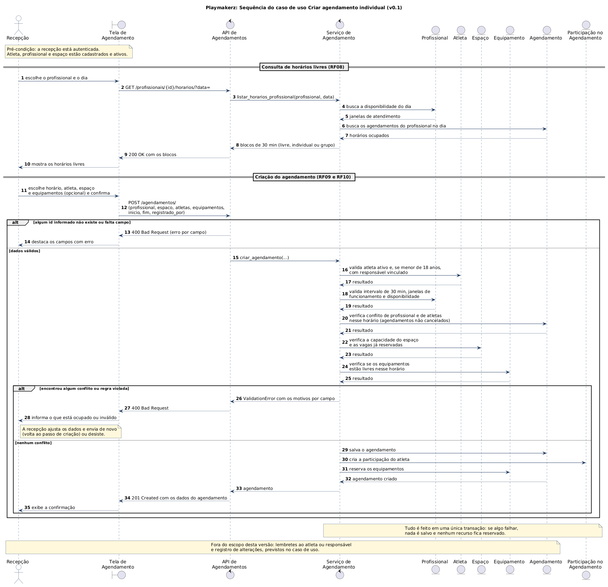
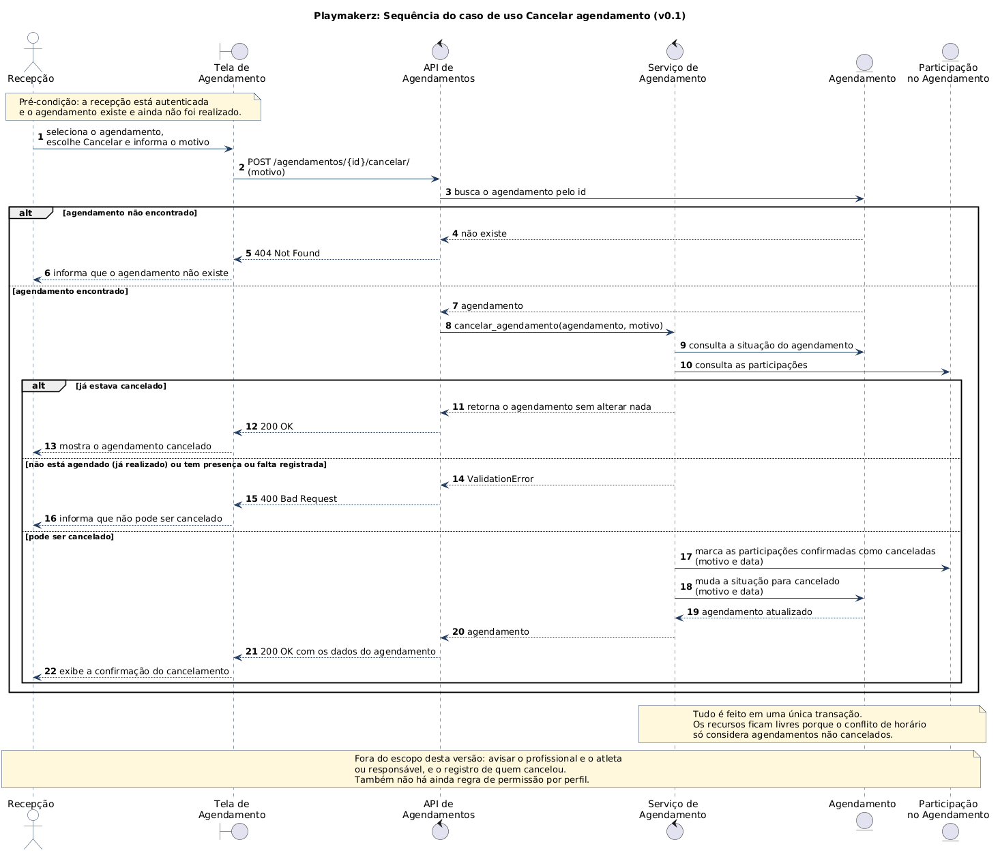

### Diagrama de Sequência

O Diagrama de Sequência é uma representação visual que mostra a interação entre objetos ou componentes ao longo do tempo. Ele é usado para modelar o comportamento dinâmico de um sistema, ilustrando como os objetos colaboram para realizar uma funcionalidade específica.	

#### Objetivo

Definir um padrão para elaboração e registro dos Diagramas de Sequência, garantindo rastreabilidade com:

- Casos de Uso
- Diagrama de Casos de Uso
- Documento de Levantamento de Requisitos
- Protótipo de Baixa Fidelidade

#### Instruções de Preenchimento

1. Selecione um Caso de Uso prioritário.
2. Identifique os requisitos funcionais e regras de negócio relacionados.
3. Mapeie as telas/fluxos no protótipo de baixa fidelidade.
4. Modele a interação entre ator(es), fronteira, controle e entidade.
5. Valide consistência com o fluxo principal e fluxos alternativos.

#### Casos de uso escolhidos
 
Seguindo o template abaixo, foram modelados os dois casos de uso prioritários da Playmakerz:
 
- **Criar agendamento individual:** é o caso de uso central do sistema (RF09) e o que mais usa a verificação de conflitos (RF10).
- **Cancelar agendamento:** é o fluxo que libera os recursos e trata os estados do agendamento (RF12).

Os casos de uso em [Casos de Uso](casos_de_uso.md) não têm ID numerado, então eles são identificados pelo nome. Os participantes de tipo Entity seguem as classes do [Diagrama de Classes](diagrama_de_classes.md) (versão v0.3).
 
---

#### Diagrama de Sequência 1: Criar agendamento individual
 
##### 1. Identificação
 
- **Caso de Uso:** Criar agendamento individual
- **ID do Caso de Uso:** sem ID numerado em [Casos de Uso](casos_de_uso.md), identificado pelo nome
- **Ator(es):** Recepção
- **Prioridade:** Alta
- **Responsável:** Maria Eduarda Alves Cruz
- **Data:** 11/11/2026

##### 2. Referências
 
- **Requisitos relacionados (ID):** RF04, RF08, RF09 e RF10
- **Diagrama de Caso de Uso (link/imagem):** [Casos de uso de agendamentos](casos_de_uso.md)
- **Protótipo de Baixa Fidelidade (tela/fluxo):** Tela 2, informações de agendamento com a verificação de disponibilidade ([Prototipagem Baixa Fidelidade](../Iniciacao/prototipo_baixa_fidelidade.md))
- **Regra(s) de negócio associada(s):** RN-01 a RN-05 (seção 7)

##### 3. Cenário Modelado
 
- **Objetivo do cenário:** criar um atendimento para um atleta, com profissional, espaço e equipamentos, sem conflito de horário.
- **Pré-condições:** a recepção está autenticada. Atleta, profissional e espaço estão cadastrados e ativos.
- **Pós-condições:** o agendamento fica salvo como agendado, com a participação do atleta e os equipamentos reservados.
- **Gatilho de início:** a recepção escolhe um profissional e um dia para agendar.

##### 4. Participantes (Lifelines)
 
- **Ator:** Recepção
- **Boundary (Interface/Tela):** Tela de Agendamento
- **Control (Orquestração):** API de Agendamentos (recebe o pedido, valida o formato e responde) e Serviço de Agendamento (aplica as regras de negócio, arquivo `services.py`)
- **Entity (Dados/Serviços):** Profissional, Atleta, Espaço, Equipamento, Agendamento e Participação no Agendamento
- **Sistemas externos (se houver):** nenhum

 
##### 5. Fluxo Principal (mensagens)
 
| Passo | Remetente | Destinatário | Mensagem/Ação | Tipo (sync/async/retorno) |
|------:|-----------|--------------|---------------|----------------------------|
| 1 | Recepção | Tela | Escolhe o profissional e o dia | sync |
| 2 | Tela | API | `GET /profissionais/{id}/horarios/?data=` | sync |
| 3 | API | Serviço | `listar_horarios_profissional` | sync |
| 4 e 5 | Serviço | Profissional | Busca a disponibilidade do dia e recebe as janelas de atendimento | sync e retorno |
| 6 e 7 | Serviço | Agendamento | Busca os agendamentos do dia e recebe os horários ocupados | sync e retorno |
| 8 a 10 | Serviço | Recepção, passando pela API e pela Tela | Devolve os blocos de 30 minutos (200 OK) e a tela mostra os horários livres | retorno |
| 11 | Recepção | Tela | Escolhe horário, atleta, espaço e equipamentos (opcional) e confirma | sync |
| 12 | Tela | API | `POST /agendamentos/` com profissional, espaço, atletas, equipamentos, início, fim e `registrado_por` | sync |
| 15 | API | Serviço | `criar_agendamento` | sync |
| 16 e 17 | Serviço | Atleta | Valida atleta ativo e, se menor de 18 anos, com responsável | sync e retorno |
| 18 e 19 | Serviço | Profissional | Valida intervalo de 30 minutos, janelas de funcionamento e disponibilidade | sync e retorno |
| 20 e 21 | Serviço | Agendamento | Verifica conflito de profissional e de atletas | sync e retorno |
| 22 e 23 | Serviço | Espaço | Verifica a capacidade e as vagas já reservadas | sync e retorno |
| 24 e 25 | Serviço | Equipamento | Verifica se os equipamentos estão livres | sync e retorno |
| 29 | Serviço | Agendamento | Salva o agendamento | sync |
| 30 | Serviço | Participação | Cria a participação do atleta | sync |
| 31 | Serviço | Equipamento | Reserva os equipamentos | sync |
| 32 a 35 | Serviço | Recepção, passando pela API e pela Tela | Devolve o agendamento criado (201 Created) e a tela mostra a confirmação | retorno |
 
##### 6. Fluxos Alternativos e Exceções
 
| ID | Condição | Descrição do fluxo | Impacto |
|----|----------|--------------------|---------|
| E1 | Algum id informado não existe ou falta um campo (passo 12) | A API responde 400 com o erro de cada campo e a tela destaca os campos (passos 13 e 14). | Nada é salvo. |
| E2 | Conflito de horário, espaço lotado, atleta menor sem responsável ou horário fora da disponibilidade (passos 16 a 25) | O serviço recusa, a API responde 400 com o motivo de cada campo e a tela informa o que está ocupado ou inválido (passos 26 a 28). A recepção ajusta os dados e envia de novo, ou desiste. | Nada é salvo e nenhum recurso é reservado. |
 
##### 7. Regras de Negócio Aplicadas
 
As regras vêm do campo "Regras de negócio" do caso de uso e foram numeradas aqui só para facilitar a referência.
 
- **RN-01:** nenhum atleta, profissional, espaço ou equipamento pode estar em dois agendamentos no mesmo horário (passos 20 a 25).
- **RN-02:** atleta menor de 18 anos precisa de responsável vinculado (passos 16 e 17).
- **RN-03:** o espaço respeita a sua capacidade (passos 22 e 23).
- **RN-04:** os agendamentos usam intervalos de 30 minutos, entre 07:00 e 12:00 ou entre 13:00 e 20:00, dentro da disponibilidade do profissional (passos 18 e 19).
- **RN-05:** o agendamento exige ao menos um atleta, um profissional, um espaço, início e fim. O equipamento é opcional (passos 12 e 13).

##### 8. Pontos de Validação
 
- [x] Fluxo compatível com Caso de Uso
- [x] Mensagens consistentes com requisitos funcionais
- [x] Alternativas/exceções representadas
- [x] Participantes aderentes à arquitetura
- [x] Correspondência com protótipo de baixa fidelidade

##### 9. Artefatos
 
- **Imagem do Diagrama de Sequência:** [`sequencia_criar_agendamento.png`](../assets/Diagrama_de_Sequencia/sequencia_criar_agendamento.png)
- **Arquivo fonte (PlantUML):** [`sequencia_criar_agendamento.puml`](../assets/Diagrama_de_Sequencia/sequencia_criar_agendamento.puml)
- **Versão:** v0.1

---
 
#### Diagrama de Sequência 2: Cancelar agendamento
 
##### 1. Identificação
 
- **Caso de Uso:** Cancelar agendamento
- **ID do Caso de Uso:** sem ID numerado em [Casos de Uso](casos_de_uso.md), identificado pelo nome
- **Ator(es):** Recepção
- **Prioridade:** Média
- **Responsável:** Maria Eduarda Alves Cruz
- **Data:** 11/11/2026

##### 2. Referências
 
- **Requisitos relacionados (ID):** RF12
- **Diagrama de Caso de Uso (link/imagem):** [Casos de uso de agendamentos](casos_de_uso.md)
- **Protótipo de Baixa Fidelidade (tela/fluxo):** não prototipado, pois o protótipo não tem a ação de cancelar
- **Regra(s) de negócio associada(s):** RN-01 a RN-04 (seção 7)

##### 3. Cenário Modelado
 
- **Objetivo do cenário:** cancelar um agendamento e liberar os recursos.
- **Pré-condições:** a recepção está autenticada e o agendamento existe.
- **Pós-condições:** o agendamento e as participações confirmadas ficam como canceladas, com motivo e data.
- **Gatilho de início:** a recepção escolhe a opção Cancelar em um agendamento.

##### 4. Participantes (Lifelines)
 
- **Ator:** Recepção
- **Boundary (Interface/Tela):** Tela de Agendamento
- **Control (Orquestração):** API de Agendamentos e Serviço de Agendamento
- **Entity (Dados/Serviços):** Agendamento e Participação no Agendamento
- **Sistemas externos (se houver):** nenhum

 
##### 5. Fluxo Principal (mensagens)
 
| Passo | Remetente | Destinatário | Mensagem/Ação | Tipo (sync/async/retorno) |
|------:|-----------|--------------|---------------|----------------------------|
| 1 | Recepção | Tela | Seleciona o agendamento, escolhe Cancelar e informa o motivo | sync |
| 2 | Tela | API | `POST /agendamentos/{id}/cancelar/` com o motivo | sync |
| 3 | API | Agendamento | Busca o agendamento pelo id | sync |
| 8 | API | Serviço | `cancelar_agendamento` | sync |
| 9 | Serviço | Agendamento | Consulta a situação do agendamento | sync |
| 10 | Serviço | Participação | Consulta as participações | sync |
| 17 | Serviço | Participação | Marca as participações confirmadas como canceladas, com motivo e data | sync |
| 18 e 19 | Serviço | Agendamento | Muda a situação para cancelado, com motivo e data, e recebe o agendamento atualizado | sync e retorno |
| 20 a 22 | Serviço | Recepção, passando pela API e pela Tela | Devolve o agendamento (200 OK) e a tela mostra a confirmação | retorno |
 
##### 6. Fluxos Alternativos e Exceções
 
| ID | Condição | Descrição do fluxo | Impacto |
|----|----------|--------------------|---------|
| E1 | O agendamento não existe (passo 3) | A API responde 404 e a tela informa que ele não existe (passos 4 a 6). | Nada é alterado. |
| A1 | O agendamento já estava cancelado (passo 9) | O serviço devolve o agendamento sem alterar nada e a API responde 200 (passos 11 a 13). | Nada é alterado. |
| E2 | O agendamento já foi realizado ou tem presença ou falta registrada (passos 9 e 10) | O serviço recusa, a API responde 400 e a tela informa que não pode cancelar (passos 14 a 16). | Nada é alterado. |
 
##### 7. Regras de Negócio Aplicadas
 
As regras vêm do campo "Regras de negócio" do caso de uso e foram numeradas aqui só para facilitar a referência.
 
- **RN-01:** só é possível cancelar um agendamento que ainda não foi realizado (passos 9 e 14).
- **RN-02:** se já houver presença ou falta registrada, o cancelamento é recusado (passos 10 e 14).
- **RN-03:** o motivo e a data do cancelamento ficam registrados (passos 17 e 18).
- **RN-04:** o cancelamento libera os recursos, porque a verificação de conflito só considera agendamentos não cancelados.

##### 8. Pontos de Validação
 
- [x] Fluxo compatível com Caso de Uso
- [x] Mensagens consistentes com requisitos funcionais
- [x] Alternativas/exceções representadas
- [x] Participantes aderentes à arquitetura
- [ ] Correspondência com protótipo de baixa fidelidade (a ação de cancelar não foi prototipada)

##### 9. Artefatos
 
- **Imagem do Diagrama de Sequência:** [`sequencia_cancelar_agendamento.png`](../assets/Diagrama_de_Sequencia/sequencia_cancelar_agendamento.png)
- **Arquivo fonte (PlantUML):** [`sequencia_cancelar_agendamento.puml`](../assets/Diagrama_de_Sequencia/sequencia_cancelar_agendamento.puml)
- **Versão:** v0.1

---
 
#### Diferenças em relação aos casos de uso
 
Os diagramas mostram o que o sistema faz hoje. Alguns pontos descritos nos casos de uso ficaram fora desta versão:
 
- **Lembretes e avisos (RF13):** não são enviados. Aparecem em nota nos dois diagramas.
- **Registro de alterações:** o sistema guarda o motivo e a data do cancelamento, mas não guarda quem cancelou.
- **Sugestão de alternativas em caso de conflito:** o sistema informa o motivo do conflito, mas não sugere outro horário. Para achar um horário livre, a recepção usa a consulta de horários (passos 1 a 10 do primeiro diagrama).
- **Permissão por perfil (RF15):** ainda não existe. Qualquer usuário autenticado consegue criar e cancelar.

#### Versionamento e revisão
 
| Versão | Data | Autor(es) | Revisor(es) | Resumo da alteração |
|--------|------|-----------|-------------|---------------------|
| v0.1 | 11/11/2026 | Maria Eduarda Alves Cruz | pendente | Preenchimento do template com os diagramas de Criar agendamento individual e Cancelar agendamento |