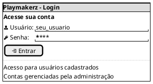
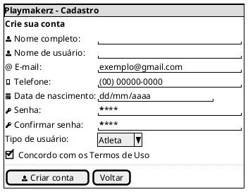
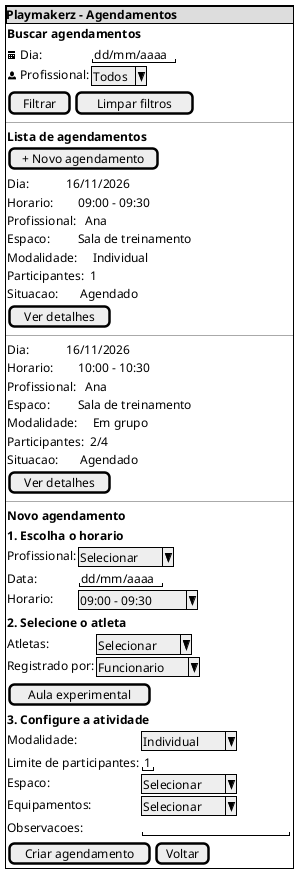

# Protótipo de Baixa Fidelidade — Playmakerz

## Tela 1 — Login e Cadastro

### Login

Observação: o acesso ao sistema é realizado por meio de nome
de usuário e senha. Cada usuário deverá ter acesso somente
às funcionalidades permitidas ao seu perfil, visando proteger
dados pessoais e sensíveis. A interface própria de login
representada no protótipo ainda não foi implementada.

### Cadastro

Observação: o cadastro contempla nome completo, nome de usuário,
e-mail, telefone, senha, confirmação de senha e tipo de usuário.
A data de nascimento deverá ser informada quando aplicável.

Observação: atletas menores de idade deverão estar associados
a um responsável para realizar agendamentos.

Observação: o cadastro de funcionários e profissionais poderá
depender de autorização administrativa. A seleção de um perfil
não deverá conceder automaticamente permissões privilegiadas.

---

## Tela 2 — Informações de Agendamento

### Consulta e Criação de Agendamentos

A tela permite consultar os agendamentos cadastrados, exibindo
data, horário, profissional, espaço, modalidade, participantes
e situação, além da opção de visualizar detalhes.

Para criar um agendamento, deverão ser informados o profissional,
a data, o horário, os atletas participantes, o funcionário
responsável pelo registro, a modalidade, o limite de participantes,
o espaço, os equipamentos e eventuais observações.

O sistema permite agendamentos individuais e em grupo, incluindo
a inscrição de novos atletas em atividades com vagas disponíveis.

### Verificação do Agendamento

Antes da confirmação, o sistema deverá verificar:

- Disponibilidade do profissional no horário selecionado;
- Conflitos de horário envolvendo atletas e profissionais;
- Disponibilidade e capacidade do espaço;
- Disponibilidade dos equipamentos selecionados;
- Limite de participantes da atividade;
- Dados necessários para o agendamento dos atletas.
- Vínculo com responsável para atletas menores de 18 anos;

Os horários são disponibilizados em intervalos de 30 minutos.

Agendamentos individuais permitem um participante. Atividades
em grupo possuem limite mínimo de dois participantes,
respeitando a capacidade do espaço.

O sistema permite inscrever atletas em atividades de grupo
existentes, desde que haja vagas disponíveis.

A opção de aula experimental permite o cadastro rápido de
interessados maiores de idade, mediante registro por um
recepcionista.

O sistema também permite cancelar agendamentos inteiros ou
participações individuais, registrando o motivo do cancelamento.

Quando a última participação ativa de uma atividade em grupo
é cancelada, o agendamento também é cancelado automaticamente.

Observação: os filtros por data e profissional representados
no protótipo ainda não estão implementados na página de
listagem atual.

## Referências

> Material Design Color Tool. Disponível em:  https://material.io/resources/color/#!/?view.left=0&view.right=0

> PMI. Um guia do conhecimento em gerenciamento de projetos. Guia PMBOK® 5a. ed. EUA: Project Management Institute, 2013.

> Ferramenta Figma. Disponível em https://www.figma.com

## Autor(es)

| Data     | Versão | Descrição                            | Autor(es)                                                                            |
| -------- | ------- | -------------------------------------- | ------------------------------------------------------------------------------------ |
|01/09/26|1.0| Criação do documento |Marcus Vinicius|
|10/11/26|2.0| Atualização conforme o sistema atual | Marcus Vinicius |

