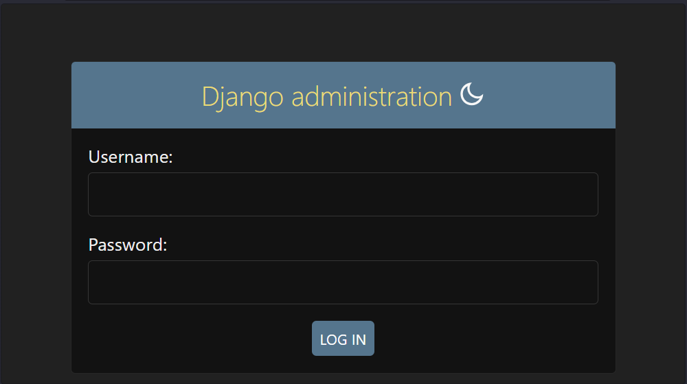
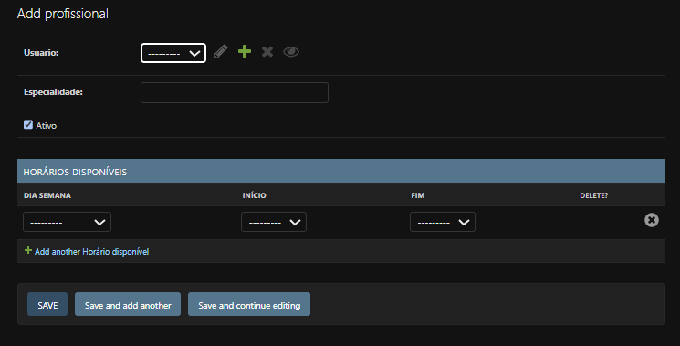
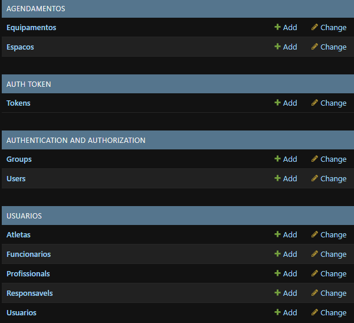
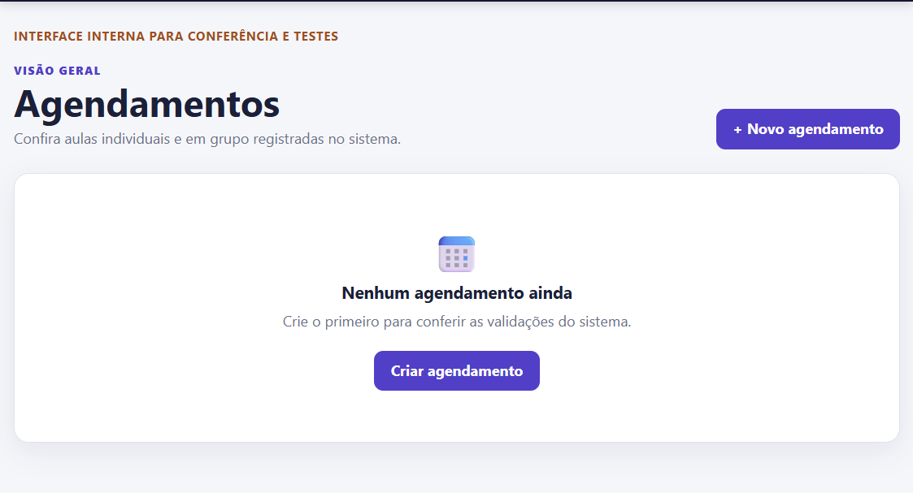
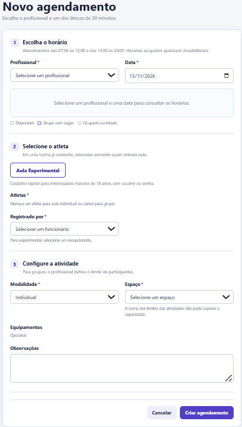
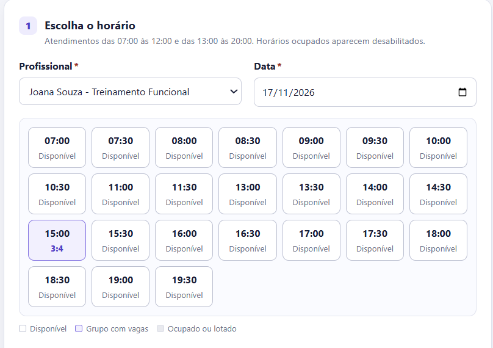
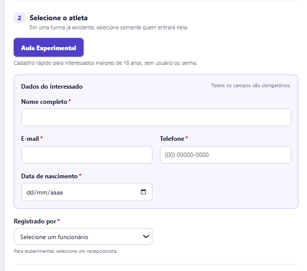
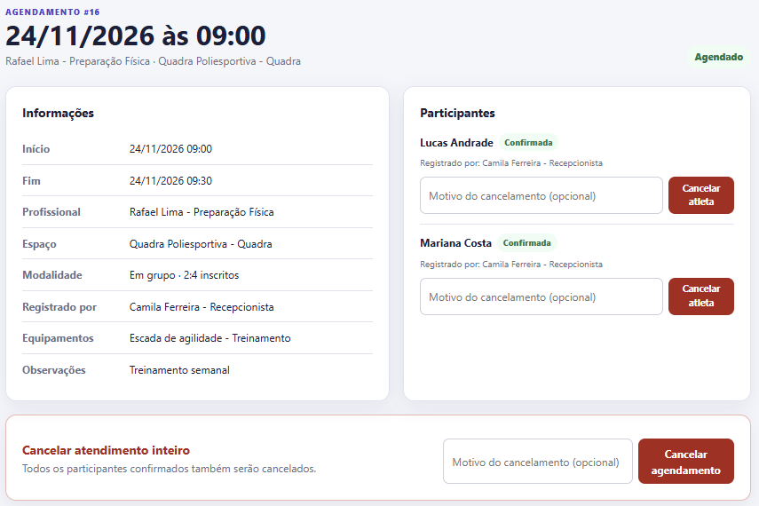

---
id: manual_do_usuario
title: Manual do Usuário
---

# Manual do Usuário — Playmakerz

**Versão:** 0.3
**Data:** 13/11/2026  
**Público:** funcionários e administradores da interface interna.

## 1. Apresentação

O Playmakerz é um sistema de gestão de atendimentos esportivos. Na versão atual, permite cadastrar usuários, consultar e criar agendamentos individuais ou em grupo, inscrever atletas em turmas, registrar aulas experimentais e realizar cancelamentos.

O sistema possui duas áreas principais:

- **Agenda:** consulta, criação, inscrição e cancelamento de agendamentos.
- **Django Admin:** cadastro e manutenção de usuários, atletas, responsáveis, profissionais, funcionários, espaços e equipamentos.

A **API REST** também está disponível para integrações, mas não constitui a principal interface do usuário. Consulte a [documentação da API](../Construcao/api.md).

## 2. Acesso ao sistema

1. Com o servidor em execução, acesse `http://127.0.0.1:8000/`. (Host Local)
2. Caso seja solicitado, faça login com uma conta autorizada no Django.
3. Acesse a **Agenda**, em `http://127.0.0.1:8000/agendamentos/`, ou a área **Admin**, em `http://127.0.0.1:8000/admin/`, de acordo com a operação desejada.

A página inicial redireciona para `agendamentos/`. A interface da Agenda exige uma conta autenticada com status **staff**.

****

### 2.1 Menu de navegação em `agendamentos/`

| Opção | Finalidade |
|---|---|
| **Playmakerz / Agenda** | Retornar à listagem de agendamentos. |
| **Novo agendamento** | Criar uma atividade ou inscrever alguém em uma turma existente. |
| **Admin** | Acessar os cadastros administrativos. |

Endereços no ambiente local: `admin/`, `agendamentos/` e `agendamentos/novo/`.

****

## 3. Preparar os cadastros no Admin

Antes de criar agendamentos, é necessário cadastrar um **profissional**, sua **disponibilidade**, um **funcionário**, um **atleta** e um **espaço**. Equipamentos são opcionais.

Os modelos exibidos no Admin dependem das permissões da conta. Em um ambiente de teste, utilize uma conta administrativa autorizada.

### 3.1 Entender os cadastros de pessoas

| Modelo | Significado |
|---|---|
| **User** (Django) | Conta com nome de usuário, senha e permissões de acesso. |
| **Usuario** (Playmakerz) | Perfil que vincula a conta Django ao sistema e possui telefone. |
| **Atleta** | Pessoa atendida; pode existir sem conta de login. |
| **Responsavel** | Pessoa que pode ser vinculada a um atleta menor de idade. |
| **Profissional** | Pessoa que conduz atendimentos e possui horários disponíveis. |
| **Funcionario** | Pessoa responsável pelo registro de operações, com cargo definido. |

Criar um **User** não cria automaticamente os perfis **Usuario**, **Funcionario** ou **Profissional**.

### 3.2 Cadastrar um profissional

1. No Admin, crie uma conta em **Users** (se ainda não existir).
2. Em **Usuarios**, crie um perfil vinculado a essa conta.
3. Em **Profissionais**, adicione um registro e selecione o perfil.
4. Preencha a especialidade e mantenha o profissional ativo.
5. Na seção de **horários disponíveis**, escolha os dias e períodos de atendimento.

As faixas permitidas são **07:00–12:00** e **13:00–20:00**, com início e fim alinhados a intervalos de 30 minutos.

****

### 3.3 Cadastrar um funcionário

1. No Admin, crie uma conta em **Users** (se ainda não existir).
2. Em **Usuarios**, crie um perfil vinculado a essa conta.
3. Em **Funcionarios**, crie o perfil, informe o cargo e salve.

O funcionário é escolhido no campo **Registrado por** durante um agendamento. Para aulas experimentais com cadastro rápido, deve ser selecionado um funcionário de cargo **Recepcionista**.

### 3.4 Cadastrar atleta e responsável

1. Em **Atletas**, selecione **Adicionar**.
2. Informe o nome, a data de nascimento e os demais dados disponíveis.
3. Caso tenha menos de 18 anos, vincule um responsável antes de realizar agendamentos.
4. Confirme que o atleta está ativo e salve.

Um atleta **não precisa ter usuário e senha** para ser cadastrado. Entretanto, a **data de nascimento** é necessária para agendar.

Para cadastrar um responsável, crie primeiro a conta em **Users**, depois seu perfil em **Usuarios** e, por fim, o registro em **Responsaveis**. No cadastro do atleta, selecione o responsável.

Cada atleta pode ter no máximo um responsável diretamente vinculado.

### 3.5 Cadastrar espaço e equipamento

1. Entre em **Espacos** ou **Equipamentos** no Admin.
2. Selecione **Adicionar** e informe nome e tipo.
3. Para espaços, preencha também a **capacidade**.
4. Salve.

A capacidade do espaço é usada para conferir a soma das vagas reservadas nos agendamentos simultâneos.

****

## 4. Consultar os agendamentos

1. Acesse a opção **Agenda** ou acesse **`http://127.0.0.1:8000/agendamentos/`**.
2. Observe a tabela com os agendamentos cadastrados.
3. Clique em **Ver detalhes** para abrir um registro.

A tabela apresenta **data e horário**, **profissional**, **espaço**, **modalidade**, **participantes** e **situação**.

Em atividades em grupo, a ocupação é exibida no formato **inscritos:limite**. Por exemplo, `2:4` representa duas pessoas inscritas em uma atividade com limite de quatro.

Se não houver registros, será exibida uma mensagem indicando que a agenda está vazia.

****

## 5. Criar um agendamento individual

1. Clique em **Novo agendamento**.
2. Na etapa **Escolha o horário**, selecione o profissional e a data.
3. Escolha um bloco marcado como **Disponível**.
4. Em **Selecione o atleta**, marque um atleta cadastrado.
5. Em **Registrado por**, escolha o funcionário responsável.
6. Na etapa **Configure a atividade**, selecione a modalidade **Individual**.
7. Escolha o espaço e, se necessário, equipamentos e observações.
8. Clique em **Criar agendamento**.
9. Confira a mensagem de sucesso e os dados na página de detalhes.

A seleção de horários utiliza blocos de **30 minutos**. Atendimentos individuais têm limite de **um participante**.

****

## 6. Criar um agendamento em grupo

1. Abra **Novo agendamento** e escolha profissional, data e horário livre.
2. Selecione pelo menos um atleta e informe o funcionário responsável.
3. Escolha a modalidade **Em grupo**.
4. Defina um **limite de participantes de pelo menos 2**, respeitando a capacidade do espaço.
5. Selecione espaço e, opcionalmente, equipamentos e observações.
6. Clique em **Criar agendamento**.
7. Confira a mensagem de sucesso e os dados na página de detalhes.

Uma atividade em grupo pode começar com apenas um atleta inscrito, desde que o limite da atividade seja de pelo menos duas vagas.

### 6.1 Inscrever um atleta em uma turma existente

1. Abra **Novo agendamento**.
2. Selecione o profissional e a data da turma.
3. Escolha o horário indicado como **Grupo com vagas**.
4. Marque **somente o atleta que deseja adicionar** e selecione o funcionário responsável.
5. Confira o aviso de entrada em atividade existente.
6. Clique em **Inscrever na atividade**.

Esse procedimento inclui o atleta na turma existente, **sem criar outro agendamento**. Grupos lotados não podem ser selecionados.

****

## 7. Registrar aula experimental

O cadastro rápido de aula experimental atende a **interessados maiores de 18 anos**, sem criação de conta de login.

1. Em **Novo agendamento**, selecione o profissional, a data e um horário livre ou grupo com vagas.
2. Clique em **Aula Experimental**.
3. Informe **nome completo, e-mail, telefone e data de nascimento**.
4. Em **Registrado por**, selecione um **Recepcionista**.
5. Se for uma nova atividade, configure modalidade e espaço; se for uma turma existente, prossiga com a inscrição.
6. Confirme a operação.

Para menores de 18 anos, o atleta e seu responsável precisam ser cadastrados antes pelo Admin.

O sistema permite apenas **uma aula experimental não cancelada por atleta**. O cancelamento de uma participação experimental pode liberar nova tentativa, conforme as validações.

****

## 8. Visualizar detalhes e cancelar

Na Agenda, clique em **Ver detalhes**. A tela mostra horários, profissional, espaço, modalidade, funcionário responsável, equipamentos, observações e participantes.

As situações gerais de agendamento são **Agendado**, **Cancelado** e **Realizado**. As participações podem ter situações como **Confirmada**, **Cancelada**, **Presente**, **Falta** e **Falta justificada**.

### 8.1 Cancelar a participação de um atleta

1. Na página de detalhes, encontre o atleta na seção **Participantes**.
2. Informe um motivo, se desejar.
3. Clique em **Cancelar atleta**.
4. Confira a mensagem e a situação atualizada.

Essa ação está disponível para participações confirmadas em agendamentos ativos. Os outros participantes de uma turma permanecem inscritos. Caso a última participação ativa seja cancelada, o agendamento também é cancelado.

### 8.2 Cancelar o agendamento inteiro

1. Abra os detalhes da atividade.
2. Na seção **Cancelar atendimento inteiro**, informe um motivo, se desejar.
3. Clique em **Cancelar agendamento**.
4. Confira a situação **Cancelado**.

O cancelamento integral também cancela as participações confirmadas. O histórico do agendamento é preservado. Agendamentos **realizados** não podem ser cancelados.

****

## 9. Regras relevantes

- **Disponibilidade:** um profissional só pode ser agendado dentro dos horários cadastrados.
- **Conflitos:** atleta, profissional e equipamento não podem estar reservados em atividades sobrepostas.
- **Espaço:** pode abrigar atividades simultâneas desde que a soma das vagas reservadas respeite a capacidade.
- **Menores:** precisam de data de nascimento e responsável vinculado para agendar.
- **Individual:** um participante.
- **Grupo:** mínimo de duas vagas, com possibilidade de novas inscrições.
- **Experimental:** cadastro rápido para maiores de 18 anos, registrado por recepcionista.

O sistema apresenta mensagens de validação quando uma operação não cumpre essas regras.

## Referências internas

- [Documentação da API REST](../Construcao/api.md)
- [Guia de integração](index.md)
- Código da interface: `src/agendamentos/templates/agendamentos/`
- Rotas e operações: `src/agendamentos/urls.py` e `src/agendamentos/views.py`
- Cadastros: `src/usuarios/models.py` e `src/usuarios/admin.py`
